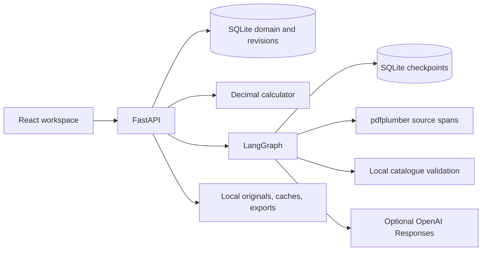

# Architecture and implementation boundaries

TenderProof is a modular monolith: React/TypeScript/Vite → FastAPI → SQLAlchemy/SQLite, a Decimal pricing engine, pdfplumber evidence extraction and a LangGraph workflow with SQLite checkpoints. PDF.js, its worker, Lucide icons and Inter fonts are bundled locally. One estimator and one active extraction run are supported.

## Contracts and ownership

`models.py` owns Pydantic contracts. `scripts/generate_contracts.py` writes `docs/openapi.json` and generated frontend domain types. Money/quantities are decimal strings; evidence coordinates are PDF-space numbers. Stable IDs derive from immutable document identities and source blocks. Physical page and printed page label remain separate.

`reference.py` loads only catalogue, productivity and project parameters. `ingestion.py` processes every page, carries canonical section context and package ownership, and preserves contradictory headings. `matching.py` compares locally retrieved candidates against units, geometry and function. Technical equivalence is independent of pricing evidence. `ai.py` validates structured interpretation against supplied source IDs and catalogue records. It cannot supply financial totals or approval.

`pricing.py` owns policy arithmetic and scope ownership. `service.py` owns review operations, optimistic concurrency and immutable revisions. `storage.py` uses short SQLite WAL transactions and `BEGIN IMMEDIATE` for revision mutations. Sources are immutable; classification state and review decisions remain separate. `exports.py` exports a selected snapshot, never the current mutable totals substituted into an older revision.

## Processing and recovery

The graph parses locally, extracts bounded four-page batches, validates/prices the draft, persists a snapshot, and interrupts for human review. The interrupt node performs no writes. Resume uses the same thread ID and an expected estimate revision. Completed batches and checkpoints survive restart. All writes are keyed/idempotent; a repeated finish does not duplicate a revision.

The current implementation issues one model request at a time, below the three-call maximum. Batches stay within canonical ventilation sections and contain at most four pages. Transient retries are bounded by the SDK; schema/evidence validation gets one repair attempt. Failed AI calls retain local results and an explicit mixed-mode error. Cancellation is checked at page/batch boundaries. CPU-heavy PDF processing runs off the API event loop. An operating-system file lock prevents two server processes from using the same data directory and interfering with job recovery.

Caches include document hash/identity, page boundaries, local parser, prompt/schema version, model, and extraction mode. Clear/version caches when parser semantics change. Progress is persisted and polled once per second. A parse attempt, extraction success, pricing, and approval are distinct metrics. Partial font extraction is retained even after the page has been attempted by the extraction stage.

## Financial policy

`benchmark_v1` applies the supplied subset convention only: material including 4% waste, unrounded installation hours, transport 2.5%, and overhead 8.5%. The 22-row baseline is CHF 414,489.12. It is never presented as the whole tender price.

`full_draft_v1` adds explicit eligible small-material and supplier-contingency allowances, transport, and configured fixed services. Package ownership prevents duplicate services; project costs remain in a visible project-level bucket. Approved risks/opportunities enter before overhead. Selling prices divide the baseline by one minus margin and round upwards to CHF 1,000. Both aggregation views reconcile to the same baseline; a disclosed display-rounding adjustment handles cent differences.

Unknown inputs are null. Known material or labour components can enter an included-scope estimate while the unresolved part remains flagged. Explicit incompatible reference/unit edits fail validation. Invalid inferred installation rules are quarantined as unresolved so they cannot abort the entire draft.

## Local operation and production path

The API listens on loopback and no authentication is provided. ZIP imports validate paths, limits and file types. Source text is untrusted; AI system prompts reject document instructions. Export text is escaped, and spreadsheet cells are guarded against formula injection. Secrets are neither returned to the browser nor committed.

A future Equans pilot can move the repository to PostgreSQL, introduce organizational identity, shared document storage and a worker queue, add supplier interfaces and monitoring, and preserve the domain/pricing/evidence boundary. Technical compliance, procurement approval and extraction quality still require estimator validation.
